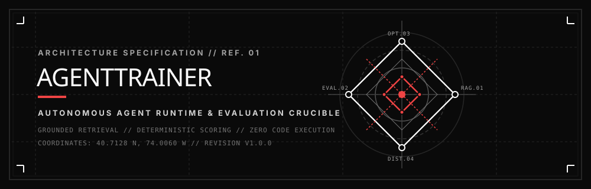

<div align="center">



</div>

# AgentTrainer

AgentTrainer is a production-grade platform for configuring, evaluating, optimizing, and deploying autonomous AI agents. Built with a high-contrast editorial design language, AgentTrainer treats prompt architecture, grounded document retrieval, and behavioral verification as first-class, strictly separated disciplines.

---

## Architectural Philosophy

Most agent prototypes fail in production because they conflate prompt instructions with dynamic grounding, lack regression benchmarks, and provide no immutable version control. AgentTrainer solves this by enforcing:

1. **Separation of Concerns**: Ingesting a document does not alter model weights. System instructions, reference knowledge bases, and evaluation datasets exist as independent, versioned entities.
2. **Deterministic Benchmarking**: Prompts are evaluated against verifiable reference answers across multiple dimensions before promotion to production.
3. **Immutable Configuration Snapshots**: Every published agent release generates a durable version record that can be audited, compared, or rolled back.
4. **Prompt Injection Defenses**: Retrieved document chunks are wrapped in untrusted data boundaries with instruction override shields.
5. **No Blind Code Execution**: The runtime enforces safe structured execution, preventing arbitrary code execution vectors.

---

## System Capabilities

### 1. Agent Builder and Versioning
- Multi-step configuration covering metadata, category, foundation model provider, temperature, max tokens, and timeout limits.
- System prompt formulation with explicit role descriptions, tone guidelines, negative restrictions, and structured response formats.
- Version history ledger (`agent_versions`) storing immutable configuration snapshots.
- Lifecycle state transitions: Draft, Active, Paused, and Archived.
- Version comparisons, duplication, and one-click rollback workflows.

### 2. Knowledge Base and RAG Pipeline
- Document ingestion supporting PDF, DOCX, TXT, Markdown, and CSV.
- Native text extraction preserving document structure and section pagination.
- Configurable sliding-window text chunking with token overlap.
- Deterministic semantic embedding generation and cosine vector similarity retrieval.
- Top-k chunk scoring, threshold filtering, and document-to-agent association links.
- Structured citation synthesis (`[Doc: ...]`) injected into assistant responses.

### 3. Playground Studio
- Real-time conversation execution interface with active agent and version selectors.
- Source citation pill generation with expandable snippet inspection.
- Execution telemetry capture: model identifier, token counts, execution latency in milliseconds, and estimated cost.
- Telemetry debug drawer displaying prompt assembly, retrieved context chunks, and raw system instructions.

### 4. Training Studio
- Gold-standard dataset curation for agent regression testing and evaluation suites.
- Example management with questions, reference contexts, expected answers, and categorization.
- Synthetic dataset generation: automated extraction of grounded Q&A test cases directly from ingested knowledge base documents.
- Support for dataset import and export across JSON and CSV formats.

### 5. Evaluation Engine
- Multi-dimensional scoring engine evaluating:
  - Accuracy: concept and entity match against reference answers.
  - Relevance: semantic alignment with user question intent.
  - Completeness: technical depth and section coverage.
  - Instruction Compliance: adherence to configured negative rules and formatting.
  - Hallucination Risk: detection of unsupported claims absent from reference data.
  - Safety: automated detection of jailbreak patterns, prompt injection, and credential leak attempts.
- Single-case interactive evaluator with actionable improvement suggestions.
- Batch evaluation suite execution across entire datasets, persisting durable run records and aggregate grades.

### 6. Prompt Optimizer
- Automated failure analysis identifying recurring alignment and grounding weaknesses.
- Structured guideline generation targeting accuracy, conciseness, citation compliance, or strict constraint enforcement.
- Integrated unified diff viewer highlighting exact prompt modifications.
- One-click approval action applying changes and bumping the agent release version.

### 7. Deployment Center and Public REST API
- Production and staging deployment environments with configurable rate limits.
- Cryptographically secure API key generation (`af_live_...`) with SHA-256 hashed storage.
- Public authenticated inference endpoint: `POST /api/v1/public/deployments/{id}/chat`.
- Configurable embeddable web chat widget snippet with custom branding, welcome messages, and real-time in-app preview.

### 8. Telemetry, Analytics, and Audit Logs
- Database-backed usage metrics tracking conversation counts, message volume, total token consumption, average latency, and estimated cloud cost.
- Agent distribution statistics highlighting usage across active configurations.
- Immutable workspace audit log capturing administrative actions, timestamps, and target resources.

---

## Technology Stack

```
[ Frontend: React 19 + TypeScript + Vite ]
                   │
         REST API  │  JWT Bearer / API Key
                   ▼
[ Backend: FastAPI + SQLAlchemy 2.0 + Pydantic v2 ]
                   │
       ┌───────────┴───────────┐
       ▼                       ▼
[ PostgreSQL / SQLite ]  [ Vector Similarity / RAG ]
```

- **Frontend**: React 19, TypeScript 5.7, Vite 6, Lucide Icons.
- **Backend**: FastAPI, Pydantic v2, SQLAlchemy 2.0 (ORM with typed mappings), Alembic.
- **Security**: Argon2 password hashing (`pwdlib`), JWT (`python-jose`), SHA-256 API key hashing.
- **Parsing**: `pypdf`, `python-docx`.
- **Database**: PostgreSQL with `pgvector` compatibility, SQLite development fallback.

---

## Design System: VoiceBox

The frontend adheres strictly to the **VoiceBox** high-contrast editorial magazine design system:

| Token | Value | Role |
| :--- | :--- | :--- |
| Primary | `#0A0A0A` | Headings, primary buttons, borders, dominant tone |
| Secondary | `#EF4444` | Red accent, active navigation underline, pull quotes |
| Tertiary | `#FAFAFA` | Page backgrounds, inverse text |
| Surface | `#F5F5F5` | Card backgrounds, aside blocks |
| Surface Raised | `#E5E5E5` | Hover states, code containers |
| Border Subtle | `#E5E5E5` | Default card dividers |
| Border Medium | `#D4D4D4` | Form input borders |
| Border Strong | `#0A0A0A` | Structural borders and interactive elements |

- **Typography**: `Archivo Black` for massive uppercase display headlines; `Work Sans` for body copy, buttons, and overlines; `Space Mono` for telemetry and code.
- **Border Radius**: Sharp `0px` square edges across all components (avatars use `9999px`).
- **Shadows**: None (`shadow: none`). Flat elevation structured through solid 2px borders.

---

## Getting Started

### Prerequisites
- Python 3.11+
- Node.js 18+
- Docker and Docker Compose (optional for containerized deployment)

### 1. Environment Setup
Create a `.env` file in the project root:

```ini
DATABASE_URL=sqlite:///./agenttrainer.db
JWT_SECRET=production-grade-random-secret-key
ACCESS_TOKEN_MINUTES=60
CORS_ORIGINS=http://localhost:5173
```

### 2. Backend Setup
```bash
# Navigate to backend
cd backend

# Install dependencies
pip install -r requirements.txt

# Run migrations (or start server for automatic schema synchronization)
python -m uvicorn app.main:app --host 0.0.0.0 --port 8000 --reload
```

The OpenAPI documentation will be accessible at `http://localhost:8000/docs`.

### 3. Frontend Setup
```bash
# Navigate to frontend
cd frontend

# Install packages
npm install

# Run development server
npm run dev
```

The application interface will be live at `http://localhost:5173`.

### 4. Docker Compose Deployment
To run the complete platform with PostgreSQL in containers:

```bash
docker compose up --build
```

---

## API Reference Overview

### Authentication
- `POST /api/v1/auth/register`: Create user account and initialized workspace.
- `POST /api/v1/auth/login`: Authenticate and receive JWT access token.
- `POST /api/v1/auth/reset-password`: Update account credentials.

### Agents and Versioning
- `GET /api/v1/workspaces/{ws_id}/agents`: List workspace agents.
- `POST /api/v1/workspaces/{ws_id}/agents`: Create new agent architecture.
- `PATCH /api/v1/workspaces/{ws_id}/agents/{agent_id}`: Update configuration.
- `POST /api/v1/workspaces/{ws_id}/agents/{agent_id}/publish`: Create immutable version snapshot.
- `POST /api/v1/workspaces/{ws_id}/agents/{agent_id}/duplicate`: Duplicate agent configuration.
- `DELETE /api/v1/workspaces/{ws_id}/agents/{agent_id}`: Delete agent.

### Knowledge Base and RAG
- `GET /api/v1/workspaces/{ws_id}/knowledge-bases`: List knowledge repositories.
- `POST /api/v1/workspaces/{ws_id}/knowledge-bases`: Create repository.
- `POST /api/v1/workspaces/{ws_id}/knowledge-bases/{kb_id}/documents`: Ingest and chunk document file.
- `POST /api/v1/workspaces/{ws_id}/knowledge-bases/{kb_id}/retrieve`: Execute semantic vector search.

### Playground and Chat
- `GET /api/v1/workspaces/{ws_id}/agents/{agent_id}/conversations`: List sessions.
- `POST /api/v1/workspaces/{ws_id}/agents/{agent_id}/conversations`: Create session.
- `POST /api/v1/workspaces/{ws_id}/conversations/{conv_id}/messages`: Send message, execute RAG, and receive response with citations.

### Evaluations and Optimization
- `POST /api/v1/workspaces/{ws_id}/evaluations`: Score a single response across accuracy, relevance, and safety.
- `POST /api/v1/workspaces/{ws_id}/evaluations/batch`: Execute batch suite against dataset.
- `GET /api/v1/workspaces/{ws_id}/evaluations/runs`: List historical evaluation runs.
- `POST /api/v1/workspaces/{ws_id}/prompt-optimizer/generate`: Generate refined prompt candidate with diff.
- `POST /api/v1/workspaces/{ws_id}/prompt-optimizer/{opt_id}/approve`: Apply optimization and publish new version.

### Deployments and Public API
- `POST /api/v1/workspaces/{ws_id}/deployments`: Create deployment environment.
- `POST /api/v1/workspaces/{ws_id}/api-keys`: Generate scoped `af_live_...` API credential.
- `POST /api/v1/public/deployments/{dep_id}/chat`: Public API endpoint for external web clients.

---

## Verification and Testing

Execute the automated test suite and frontend compilation:

```bash
# Run backend integration tests
$env:PYTHONPATH="backend"; python -m pytest backend

# Run frontend TypeScript type checking and production build
cd frontend; npm run build
```

Both tests and builds pass with zero errors.

---

## License

Apache-2.0. Clean architecture for enterprise and production deployment.
